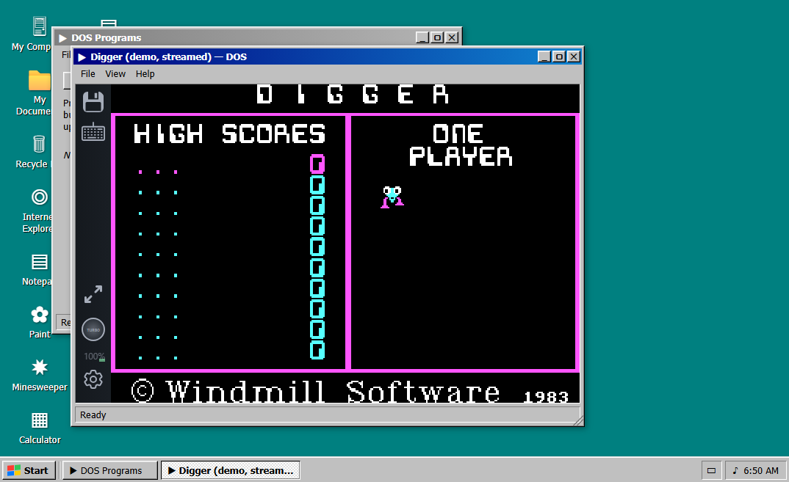
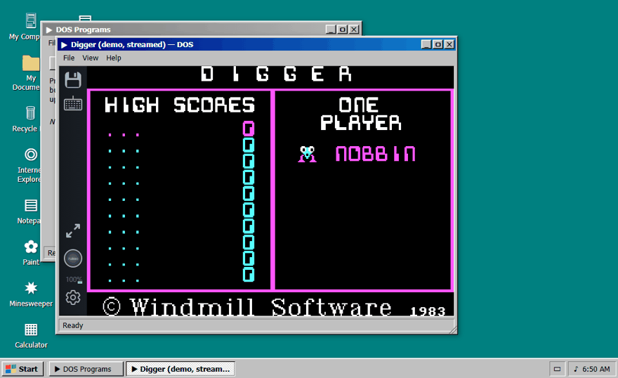

# win98-run

**Live: https://win98run.app**



## What is this?

win98-run is Windows 98 in your browser — a boot sequence, desktop, Start
menu, taskbar, and working windows — with a real DOS emulator (js-dos /
DOSBox) inside it.

Bring your own DOS games and apps. Drop in a `.zip`, a `.jsdos` bundle, or a
single DOS `.EXE`, `.COM`, or `.BAT`, and it runs in a window on the desktop.
Your programs are stored only in your browser (IndexedDB). Nothing is
uploaded, there is no account, and there is no server-side file storage.

No game library is included or distributed. A streamed Digger demo is built
into DOS Programs so you can try the emulator instantly.



Inspired by win32.run, OpenLair XP, and Quenq's Reborn XP. This is a
simulation with an emulator inside, not a full Windows emulator: Windows
`.EXE` files do not run yet. Not affiliated with Microsoft.

## Run

```powershell
npm start
```

Open http://localhost:9898/

No build step and no dependencies. Requires Node 18+.

## What is included (MVP)

- BIOS + Windows 98-style boot sequence (click to skip)
- Draggable, resizable, minimizable, maximizable windows with taskbar buttons
- Start menu, system tray clock, desktop right-click menu, Shut Down / Restart
- Apps: My Computer / Explorer, Notepad, Paint, Minesweeper, Calculator,
  Internet Explorer (offline start page), Display Properties, System Properties
- Persistent virtual files: Notepad documents and wallpaper choice survive reload
- Drag real `.txt` / `.md` files onto the desktop to open them in Notepad;
  drop an image to use it as wallpaper
- **Run your own DOS games/apps** (js-dos / DOSBox): open **DOS Programs**,
  or Start → Run Program…, or drag a file onto the desktop. Provide a `.zip`
  containing a DOS `.EXE`/`.COM`/`.BAT`, a `.jsdos` bundle, or a single DOS
  executable. Bundles are stored in IndexedDB in your browser (nothing is
  uploaded) and listed in DOS Programs for next time. js-dos persists local
  file changes/saves per program. Windows `.EXE` files do not run in DOS mode.
  DOS import and playback load JSZip and the js-dos runtime from CDNs, so
  they need an internet connection. A streamed Digger demo is included under
  DOS Programs to smoke-test the runtime.
- DOS Programs library: search, rename, export (`.jsdos` backup), delete, and
  per-program settings — DOSBox or DOSBox-X backend and CPU cycles — plus a
  fullscreen button in the player window.

## Ideas borrowed from the reference sites

- win32.run: fully client-side session, virtual file system, recreated apps
- OpenLair XP (xp.openlair.com): boot sequence and sign-in style entry flow
- Quenq Reborn XP (quenq.com/apps/reborn-xp): persistent IndexedDB-style file
  system, themes via Display Properties, drag-and-drop file import

## v86 spike (experimental)

**Win98 Image (v86)** on the desktop / Start menu runs a real x86 PC emulator
([v86](https://github.com/copy/v86)) in a window. Import your own bootable
Windows 98 hard-disk image (`.img`, optionally with an `.iso` CD attached) —
the image is stored only in your browser and never uploaded. We do not
supply a Windows image. Small images mount as a floppy, larger ones as a
hard disk (128 MB RAM). A bundled FreeDOS floppy (see
`assets/FREEDOS-NOTICE.txt`) tests the engine.

Spike findings: the emulator starts in ~1s and a DOS floppy reaches its
prompt in seconds at a smooth UI rate. Windows 98 itself is untested here
because it needs a user-prepared image (see v86's Windows 9x guide). Known
gaps: disk changes are not saved back yet, no 3D acceleration, sound is
best-effort, and large images take significant browser storage.

## Next steps

- v86: save disk changes/states back to IndexedDB, prepared-image guidance,
  then Boxedwine for standalone Win32 `.exe` files
- IndexedDB file system with folders, rename/delete, and file picker dialogs
- More apps: Media Player, Solitaire, WordPad, MS-DOS Prompt, Help
- Sounds, multiple wallpapers/themes (98SE / 2000 / ME skins on the same engine)
- Mobile touch layout
